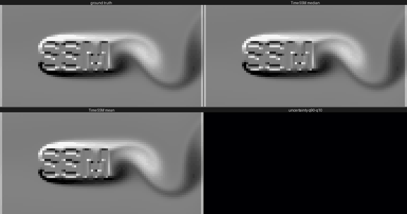

# TimeSSM-2.5M



A 2.5M-parameter zero-shot time series forecaster built on a diagonal linear state space
model (S4D), trained from scratch on 15.85 billion observations of public time series.
It forecasts any horizon in one pass, outputs nine quantiles, and exposes its sampling
interval as an inference-time knob: the same weights run a series at any rate.

It was trained by one person on three RTX 3090s, outside of any lab or company.

The animation is a lattice-Boltzmann flow past an obstacle shaped like the
letters, 48 by 96 pixels, each pixel forecast as its own series 256 frames
ahead from 1024 frames of context, with the sampling interval set from the
shedding period. The red frame marks the end of the context. Mean absolute
error over the horizon: 0.0094 against 0.0458 for freezing the last frame;
empirical 80 % coverage 0.785.

## GIFT-Eval results

97 configurations, zero-shot. MASE and CRPS are geometric means of the ratio to the
official seasonal naive, as on the leaderboard. Lower is better. All numbers come from the
released checkpoint, the last one of its training run; no checkpoint was picked on
GIFT-Eval. The evaluation harness reproduces t0-beta's official per-configuration results
on 97 of 97 configurations.

### With inference-time backtest resampling

| | MASE | CRPS |
|---|---|---|
| **TimeSSM-2.5M + backtest resampling** | **0.7544** | **0.5128** |

The context is resampled at several rates (decimation by 2 to 48, upsampling by 2 to 4)
and forecast at each; a causal backtest on the series' own past weights the candidates and
the forecasts are mixed per quantile level, with sign-flip averaging. The quantile fan is
widened by nine per-level factors calibrated on the training corpus. Nothing is fitted on
GIFT-Eval data. It costs 20 to 40 forecasts per series instead of one.

### Bare model

| | MASE | CRPS |
|---|---|---|
| TimeSSM-2.5M | 0.7985 | 0.5451 |

One forward pass per series, no averaging, no resampling, no calibration.

### Where it stands

Among the models of the GIFT-Eval leaderboard under 10M parameters, sorted by
CRPS (leaderboard numbers and parameter counts from its metadata; the two
TimeSSM rows and the Chronos-Bolt rows from this harness):

| Model | Parameters | CRPS ratio |
|---|---|---|
| FlowState-9.1M | 9.1M | 0.502 |
| **TimeSSM-2.5M + backtest resampling** | **2.5M** | **0.513** |
| TTM-R3 | 1.4M | 0.520 |
| Toto-2.0-4m | 4.1M | 0.524 |
| Chronos-Bolt tiny + the same resampling layer | 9M | 0.532 |
| TempoPFN | n/a | 0.533 |
| TinyCast | 0.1M | 0.545 |
| **TimeSSM-2.5M** | **2.5M** | **0.545** |
| goia-forecast-nano | 4.7M | 0.553 |
| Kairos-10m | 9.9M | 0.554 |
| Metamorph-4.5M | n/a | 0.555 |
| Chronos-Bolt tiny | 9M | 0.601 |
| YingLong-6m | 7.3M | 0.609 |

TTM-R3 saw GIFT-Eval data in pretraining. Above 10M for scale: Chronos-Bolt
small (48M) is at 0.564 bare and 0.515 with the same resampling layer; bare
against bare, TimeSSM-2.5M beats it on both metrics.

### Per configuration

Ratios to the official seasonal naive, released checkpoint, with backtest resampling and
bare.

<details>
<summary>97 configurations</summary>

| Configuration | MASE (resampling) | CRPS (resampling) | MASE (bare) | CRPS (bare) |
|---|---|---|---|---|
| bitbrains_fast_storage/5T/long | 0.897 | 0.681 | 0.851 | 0.764 |
| bitbrains_fast_storage/5T/medium | 0.910 | 0.612 | 0.861 | 0.578 |
| bitbrains_fast_storage/5T/short | 0.714 | 0.350 | 0.683 | 0.339 |
| bitbrains_fast_storage/H/short | 0.935 | 0.658 | 0.890 | 0.671 |
| bitbrains_rnd/5T/long | 0.992 | 0.563 | 0.989 | 0.464 |
| bitbrains_rnd/5T/medium | 0.997 | 0.496 | 0.993 | 0.465 |
| bitbrains_rnd/5T/short | 0.933 | 0.400 | 0.899 | 0.377 |
| bitbrains_rnd/H/short | 1.001 | 0.472 | 0.988 | 0.441 |
| bizitobs_application/10S/long | 1.109 | 1.215 | 1.244 | 1.410 |
| bizitobs_application/10S/medium | 1.066 | 1.044 | 1.466 | 1.373 |
| bizitobs_application/10S/short | 0.868 | 0.491 | 0.859 | 0.579 |
| bizitobs_l2c/5T/long | 0.310 | 0.311 | 0.852 | 0.931 |
| bizitobs_l2c/5T/medium | 0.375 | 0.379 | 0.689 | 0.704 |
| bizitobs_l2c/5T/short | 0.291 | 0.293 | 0.358 | 0.377 |
| bizitobs_l2c/H/long | 0.376 | 0.262 | 0.390 | 0.272 |
| bizitobs_l2c/H/medium | 0.318 | 0.251 | 0.329 | 0.264 |
| bizitobs_l2c/H/short | 0.388 | 0.385 | 0.428 | 0.421 |
| bizitobs_service/10S/long | 0.999 | 0.969 | 1.771 | 1.324 |
| bizitobs_service/10S/medium | 0.892 | 0.621 | 1.773 | 1.187 |
| bizitobs_service/10S/short | 0.737 | 0.370 | 0.992 | 0.502 |
| car_parts/M/short | 0.783 | 0.622 | 0.698 | 0.560 |
| covid_deaths/D/short | 0.843 | 0.289 | 0.823 | 0.338 |
| electricity/15T/long | 0.787 | 0.689 | 0.806 | 0.713 |
| electricity/15T/medium | 0.779 | 0.707 | 0.786 | 0.714 |
| electricity/15T/short | 0.682 | 0.620 | 0.651 | 0.587 |
| electricity/D/short | 0.761 | 0.569 | 0.752 | 0.570 |
| electricity/H/long | 0.918 | 0.685 | 0.959 | 0.753 |
| electricity/H/medium | 0.826 | 0.641 | 0.842 | 0.686 |
| electricity/H/short | 0.711 | 0.635 | 0.731 | 0.658 |
| electricity/W/short | 0.673 | 0.484 | 0.703 | 0.532 |
| ett1/15T/long | 0.846 | 0.679 | 0.888 | 0.749 |
| ett1/15T/medium | 0.839 | 0.722 | 0.888 | 0.797 |
| ett1/15T/short | 0.766 | 0.689 | 0.796 | 0.724 |
| ett1/D/short | 0.945 | 0.676 | 0.952 | 0.679 |
| ett1/H/long | 0.926 | 0.580 | 0.947 | 0.629 |
| ett1/H/medium | 0.830 | 0.604 | 0.884 | 0.656 |
| ett1/H/short | 0.851 | 0.751 | 0.876 | 0.776 |
| ett1/W/short | 0.837 | 0.809 | 0.891 | 0.882 |
| ett2/15T/long | 0.898 | 0.720 | 0.954 | 0.757 |
| ett2/15T/medium | 0.845 | 0.737 | 0.914 | 0.806 |
| ett2/15T/short | 0.712 | 0.698 | 0.727 | 0.712 |
| ett2/D/short | 1.119 | 0.747 | 0.999 | 0.643 |
| ett2/H/long | 1.020 | 0.569 | 0.987 | 0.547 |
| ett2/H/medium | 0.913 | 0.607 | 0.897 | 0.608 |
| ett2/H/short | 0.853 | 0.793 | 0.872 | 0.811 |
| ett2/W/short | 1.165 | 0.738 | 1.309 | 0.845 |
| hierarchical_sales/D/short | 0.669 | 0.338 | 0.659 | 0.335 |
| hierarchical_sales/W/short | 0.700 | 0.407 | 0.692 | 0.399 |
| hospital/M/short | 0.860 | 0.878 | 0.880 | 0.895 |
| jena_weather/10T/long | 0.849 | 0.204 | 0.850 | 0.209 |
| jena_weather/10T/medium | 0.845 | 0.226 | 0.859 | 0.231 |
| jena_weather/10T/short | 0.387 | 0.174 | 0.408 | 0.191 |
| jena_weather/D/short | 0.693 | 0.220 | 0.683 | 0.230 |
| jena_weather/H/long | 0.808 | 0.140 | 0.838 | 0.146 |
| jena_weather/H/medium | 0.961 | 0.151 | 1.113 | 0.165 |
| jena_weather/H/short | 0.720 | 0.273 | 0.743 | 0.275 |
| kdd_cup_2018/D/short | 0.785 | 0.554 | 0.800 | 0.562 |
| kdd_cup_2018/H/long | 0.762 | 0.479 | 0.785 | 0.490 |
| kdd_cup_2018/H/medium | 0.732 | 0.563 | 0.746 | 0.573 |
| kdd_cup_2018/H/short | 0.713 | 0.699 | 0.729 | 0.719 |
| loop_seattle/5T/long | 0.652 | 0.572 | 0.805 | 0.719 |
| loop_seattle/5T/medium | 0.753 | 0.655 | 0.819 | 0.730 |
| loop_seattle/5T/short | 0.716 | 0.582 | 0.774 | 0.635 |
| loop_seattle/D/short | 0.517 | 0.421 | 0.517 | 0.430 |
| loop_seattle/H/long | 0.607 | 0.339 | 0.657 | 0.369 |
| loop_seattle/H/medium | 0.668 | 0.422 | 0.680 | 0.427 |
| loop_seattle/H/short | 0.675 | 0.588 | 0.701 | 0.609 |
| m4_daily/D/short | 1.114 | 1.008 | 1.189 | 1.060 |
| m4_hourly/H/short | 1.419 | 0.709 | 1.543 | 0.750 |
| m4_monthly/M/short | 0.827 | 0.828 | 0.840 | 0.846 |
| m4_quarterly/Q/short | 0.795 | 0.804 | 0.835 | 0.842 |
| m4_weekly/W/short | 0.909 | 0.659 | 0.994 | 0.696 |
| m4_yearly/A/short | 0.921 | 0.935 | 0.896 | 0.898 |
| m_dense/D/short | 0.432 | 0.307 | 0.424 | 0.301 |
| m_dense/H/long | 0.597 | 0.349 | 0.589 | 0.346 |
| m_dense/H/medium | 0.483 | 0.333 | 0.487 | 0.335 |
| m_dense/H/short | 0.558 | 0.502 | 0.581 | 0.520 |
| restaurant/D/short | 0.692 | 0.388 | 0.684 | 0.385 |
| saugeen/D/short | 0.836 | 0.581 | 0.927 | 0.660 |
| saugeen/M/short | 0.745 | 0.653 | 0.718 | 0.623 |
| saugeen/W/short | 0.583 | 0.477 | 0.591 | 0.490 |
| solar/10T/long | 1.031 | 0.514 | 1.101 | 0.546 |
| solar/10T/medium | 0.933 | 0.520 | 0.972 | 0.526 |
| solar/10T/short | 1.002 | 0.683 | 1.017 | 0.628 |
| solar/D/short | 0.881 | 0.523 | 0.927 | 0.530 |
| solar/H/long | 0.973 | 0.337 | 0.911 | 0.326 |
| solar/H/medium | 0.943 | 0.345 | 0.930 | 0.355 |
| solar/H/short | 0.911 | 0.559 | 0.899 | 0.552 |
| solar/W/short | 0.655 | 0.618 | 0.782 | 0.740 |
| sz_taxi/15T/long | 0.736 | 0.457 | 0.728 | 0.455 |
| sz_taxi/15T/medium | 0.761 | 0.537 | 0.752 | 0.534 |
| sz_taxi/15T/short | 0.717 | 0.655 | 0.719 | 0.660 |
| sz_taxi/H/short | 0.760 | 0.635 | 0.787 | 0.664 |
| temperature_rain/D/short | 0.672 | 0.437 | 0.669 | 0.438 |
| us_births/D/short | 0.255 | 0.209 | 0.294 | 0.239 |
| us_births/M/short | 1.110 | 1.071 | 0.910 | 0.875 |
| us_births/W/short | 0.764 | 0.745 | 0.707 | 0.645 |

</details>

## How to read the numbers

- The model receives the declared sampling frequency of the series and sets its sampling
  interval to 24 / season, the convention of FlowState ([Graf et al., 2025](https://arxiv.org/abs/2508.05287)). It was trained this way. Evaluated
  without the frequency it is not the model of this card.
- Zero-shot: the training corpus excludes the GIFT-Eval sources by construction.
- The harness recomputes the leaderboard metrics from the raw data with the official
  seasonal-naive denominators. Chronos-Bolt numbers are from chronos-forecasting 2.3.2,
  whose medium- and long-horizon results differ from the leaderboard's.

## Model

Six gated S4D blocks (complex diagonal state, d_model 192, d_state 32), one token per time
step, a learned future token for the horizon, a quantile head with cross-attention on the
context. 2,525,771 parameters. Robust arcsinh scaling and instance normalization from the
context. Any horizon, no autoregressive loop. Nine quantiles, 0.1 to 0.9.

Trained on three RTX 3090s with a pinball loss on the nine quantiles, on a corpus of 106
files (LOTSA subsets at a pinned revision, four Chronos datasets, synthetic families).

## Limitations

- The bare model is a short-horizon model; the resampling layer carries the medium and
  long terms.
- Weakest groups: 10-second cloud-operations traces, hourly data with a weekly cycle
  (m4_hourly), low-frequency economic series (m4 weekly and yearly).
- The resampling layer multiplies inference cost by 20 to 40.
- Univariate. The frequency must be declared; there is no detector.

## Inference

```bash
pip install git+https://github.com/IUseAMouse/TimeSSM.git
```

```python
import numpy as np
import torch
from timessm import from_pretrained, delta_scale

model = from_pretrained("IUseAMouse/timessm-2.5m")   # or a local directory; device="cuda" to run there

series = np.sin(np.arange(1024) * 2 * np.pi / 24)   # your history: raw values, any scale
context = torch.tensor(series, dtype=torch.float32).unsqueeze(0)   # [1, length]
w = delta_scale(24, *model.delta_range)   # season length in steps: 24 for hourly data with a daily cycle
with torch.no_grad():
    out = model.forecast(context, 48, w=w)
quantiles = out["quantiles_denorm"][0]   # [48, 9], levels 0.1 to 0.9; column 4 is the median
```

The first argument of `delta_scale` is the season length of the declared frequency, in
steps: 96 for 15-minute data, 24 for hourly, 7 for daily data with a weekly cycle, 12 for
monthly. The function divides 24 by it and clamps the result to the range the model was
trained on, so `w` is 0.25 for 15-minute data and 1 for hourly data. The backtest
resampling layer runs through the evaluation harness, see the repository.

## Reproduction

The submitted number (MASE 0.7544, CRPS 0.5128) is produced by one command of the
[TimeSSM repository](https://github.com/IUseAMouse/TimeSSM), whose config
`configs/timessm_2.5m_gift.yaml` carries every inference setting of this card: the
frequency rule, sign-flip averaging, backtest resampling (decimation by 2 to 48,
upsampling by 2 to 4, pooled backtest on four windows) and the calibration file. The bare
number is the second command.

```bash
git clone https://github.com/IUseAMouse/TimeJEPA && git clone https://github.com/IUseAMouse/TimeSSM
cd TimeJEPA && make gift-download && cd ../TimeSSM && uv sync --extra train
CK=epoch00_valloss1.2814.ckpt                                              # from this repository
EVAL_CONFIG=timessm_2.5m_gift scripts/eval_ssm.sh $CK                      # MASE 0.7544, CRPS 0.5128
EVAL_CONFIG=ssm_mini_v3_freq_eval scripts/eval_ssm.sh $CK +freq_delta=true # bare: MASE 0.7985, CRPS 0.5451
```

The harness writes `all_results.csv` in the leaderboard's format and a JSON per
configuration. It recomputes the leaderboard metrics from the raw data with gluonts'
conventions and reproduces t0-beta's official per-configuration results on 97 of 97
configurations.

## Files and license

- Weights: `model.safetensors` with `config.json` (read by `timessm.from_pretrained`),
  the calibration factors, the frequency table, and the original Lightning
  checkpoint `epoch00_valloss1.2814.ckpt` for exact reproduction through the harness.
- Code: [TimeSSM](https://github.com/IUseAMouse/TimeSSM) (model, Apache-2.0) and
  [TimeJEPA](https://github.com/IUseAMouse/TimeJEPA) (harness, MIT).
- Weights license: Apache-2.0, the same as the code.

## Citation

```bibtex
@misc{vincent2026timessm,
  author = {Vincent, Yvann},
  title  = {TimeSSM: a state space forecaster with a rate knob},
  year   = {2026},
  url    = {https://github.com/IUseAMouse/TimeSSM}
}
```

The frequency rule follows FlowState:

```bibtex
@article{graf2025flowstate,
  title   = {FlowState: Sampling Rate Invariant Time Series Forecasting},
  author  = {Graf, Lars and Ortner, Thomas and Wo{\'z}niak, Stanis{\l}aw and Pantazi, Angeliki},
  journal = {arXiv preprint arXiv:2508.05287},
  year    = {2025}
}
```
